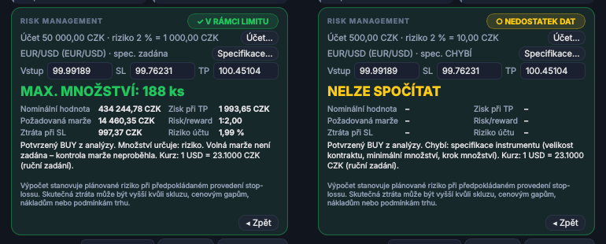
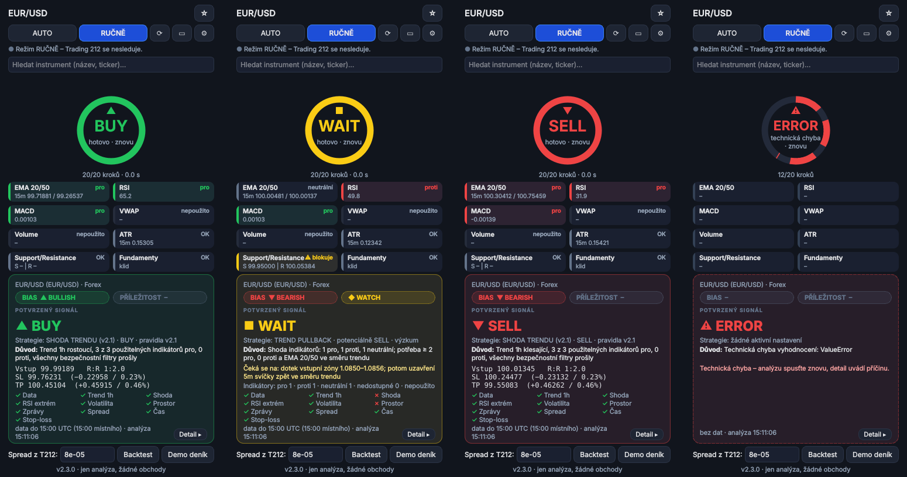

# CFD Signal Calculator

Malá desktopová aplikace pro Windows, kterou lze nechat nad Trading 212. Rozpozná zvolený instrument
z vybrané oblasti obrazovky, stáhne svíčky z Twelve Data a vrátí **BUY / SELL / WAIT** s vysvětlením
a návrhem stop-lossu a take-profitu. Od verze 2.3 navíc ukazuje **MARKET BIAS** (směr trhu) a **WATCH**
(blížící se obchodní nastavení s tím, co přesně chybí). Verze 2.4 přidává **RISK MANAGEMENT**: maximální velikost
pozice podle hodnoty účtu, rizika v %, vstupu a stop-lossu.

**Aplikace nikdy nezadává obchody.** Neobsahuje žádné napojení na broker, obchod zadáváte ručně.
Výsledky nejsou investiční doporučení a ziskovost strategie není ověřena.

## Instalace a spuštění (vývojově)

```bat
python -m venv .venv && .venv\Scripts\activate
pip install -e ".[dev]"
python -m cfdcalc
```

Požadavky: Windows 10/11, Python ≥ 3.12. OCR (RapidOCR) běží offline, nic dalšího se neinstaluje.

## Windows EXE

* Lokálně: `build_exe.bat` – vytvoří venv, spustí testy (při selhání EXE nevznikne) a PyInstallerem
  sestaví `dist\CFD Signal Calculator\CFD Signal Calculator.exe`. Ke sdílení zabalte celou složku do ZIP.
* V CI: workflow `.github/workflows/build.yml` na `windows-latest` spustí testy, sestaví EXE
  a nahraje jej jako artefakt `cfd-signal-calculator-windows`.
* Složka má kolem 300–450 MB (Qt, OpenCV a ONNX Runtime pro OCR). Volíme sestavení do složky, ne `--onefile`,
  protože jinak by se při každém startu rozbalovaly stovky MB.

## Ovládání

1. **⚙ Nastavení** – API klíč Twelve Data (zdarma na twelvedata.com), případně proměnná prostředí
   `TWELVEDATA_API_KEY`, která má přednost. Dále večerní limit (výchozí 21:00 místního času) a minimální počet minut
   do limitu (výchozí 60).
2. Otevřete **Trading 212** (desktopovou aplikaci, nebo web v prohlížeči jako aktivní záložku) a zvolte instrument.
3. Zadejte **spread z T212** (rozdíl BUY − SELL v cenových jednotkách). Předvyplněná hodnota je jen hrubý odhad.
4. **START** (kliknutí do kruhu). Analyzuje se vždy jen potvrzený instrument (viz níže).

### Ukazatel 1–100 % a plynulé rozhraní (verze 2.1)

* Analýza má 20 skutečných kroků: instrument, 3× stažení a 3× ověření dat (5m, 15m, 1h), kalendář zpráv,
  8 modulů, trend 1h, spread, časový limit a rozhodnutí. Procento je `hotové kroky / 20`, kruh se k němu plynule
  dotáčí.
* Při čekání na Twelve Data se kolem kruhu točí krátký segment s textem „čekám na Twelve Data…“. Je to jen
  znamení, že se čeká; nejde o smyšlená procenta.
* **Kliknutím na kruh běžící analýzu zrušíte.** Analýza má navíc celkový časový limit 75 s a každý síťový dotaz
  15 s. Výsledek zrušené analýzy se nikdy nezobrazí.
* Okno má pevnou velikost a při změnách neposkakuje. Barvy START/BUY/SELL/WAIT/NO DATA a dlaždice indikátorů se
  mění plynulým přechodem. Překresluje se jen to, co se opravdu změnilo.
* OCR model se načítá na pozadí hned po zobrazení okna. START použije čtení Trading 212, které právě běží,
  místo aby čekal ve frontě. Čtení, které visí déle než 8 s, START neblokuje.
* Při zavření okna se pracovní vlákna bezpečně ukončí.

## Verze 2.5: široké pokrytí trhů a oprava NO DATA

Podrobné porovnání poskytovatelů a cen je v [docs/poskytovatele-dat.md](docs/poskytovatele-dat.md).

### Proč bylo tolik NO DATA (audit)

| Příčina | Dopad ve v2.4 | Řešení ve v2.5 |
|---|---|---|
| Stříbro, ropa WTI/Brent jsou u Twelve Data až v tarifu **Grow** (ověřeno `show_plan`) | na bezplatném tarifu HTTP 404 → NO DATA | ⚙ **Tarif Twelve Data**: symboly vyššího tarifu se nestahují (žádný zbytečný dotaz). Stříbro, ropa a plyn se analyzují z **referenčních ETF** (SLV, USO, UNG), jen směr. |
| Indexy (SPX, NDX, DJI, DAX, FTSE) Twelve Data pod těmito symboly nemá | vždy NO DATA | referenční ETF: SPY, QQQ, DIA, IWM, Global X DAX, EWU; jen směr |
| Malý katalog (37 instrumentů) | ostatní instrumenty z Trading 212 neznámé | **167 instrumentů** s ověřenou identitou a **adresář symbolů** (Trhy → Přidat instrument) |
| Neoficiální kalendář zpráv omezuje dotazy; po 6 h bez stažení NO DATA u **všech** instrumentů | časté NO DATA bez souvislosti s trhem | týdenní kalendář platí až 24 h, pokud pokrývá dnešek. Bez kalendáře se i tak spočítá bias a WATCH. |
| Víkend u forexu a komodit | „zastaralá data“ = NO DATA | WAIT „trh je o víkendu zavřený“, bez dotazu |
| Limit 8 dotazů/min a 800/den | NO DATA „překročen limit“ | krypto z Coinbase (bez kreditů TD), cache, Retry-After, denní počítadlo, zbývající kredity na stránce Trhy |

### Zdroje dat

* Každý instrument má seznam **zdrojů**. Nejdřív se zkouší přesné (stejný podkladový instrument), pak referenční.
  Všechny tři časové rámce pocházejí vždy z **jednoho** zdroje, řady se nikdy nekombinují.
* **Twelve Data** zůstává hlavním zdrojem. Burza je u akcií a ETF pevně daná a každá odpověď se kontroluje
  (symbol, burza, měna).
* **Coinbase Exchange** (veřejné API, bez klíče, burzovní objem) je hlavní zdroj pro 12 kryptoměn; Twelve Data slouží
  jako záloha.
* **Referenční data** jsou označená textem „REFERENČNÍ TRŽNÍ DATA – NEMUSÍ ODPOVÍDAT CENĚ TRADING 212 CFD.“
  Dávají jen směr: žádný vstup, SL, TP, zápis do deníku ani předvyplnění Risk Managementu. Spread T212 se s cenou ETF
  nesrovnává.

### Pokrytí (bezplatný tarif Twelve Data Basic)

| Trh | Instrumentů | Plná analýza | Jen směr (referenční) | Vyžaduje vyšší tarif |
|---|---|---|---|---|
| Forex | 43 | 43 | – | – |
| Americké akcie a ADR | 67 | 67 | – | – |
| Evropské akcie (XETR, Euronext, LSE, SIX) | 14 | – | – | 14 (Grow, SIX Pro) |
| ETF | 18 | 18 | – | – |
| Kryptoměny | 12 | 12 | – | – |
| Komodity | 7 | 1 (zlato) | 3 (stříbro, WTI, plyn) | 3 (Brent, platina, palladium) |
| Indexy | 6 | – | 6 | – |
| **Celkem** | **167** | **141** | **9** | **17** |

Ve verzi 2.4 bylo 37 instrumentů a na tarifu Basic šlo analyzovat 28. Devět (24 %) vracelo NO DATA vždy.
S tarifem **Grow** přibude plná analýza stříbra, ropy, platiny, palladia a evropských akcií z XETR, Euronextu a LSE.

### Stránka DOSTUPNOST TRŽNÍCH DAT (tlačítko Trhy)

Pro každý instrument ukazuje: název, typ trhu, poskytovatele, časové rámce, zpoždění, stav API, poslední ověření,
přesný/referenční zdroj a zda je možná plná analýza. Umožňuje vyhledávání a filtrování podle kategorie a ukazuje
spotřebu limitu Twelve Data. Bez nových dotazů na API.

**Přidat instrument…** vyhledá v adresáři symbolů Twelve Data (1 dotaz) a přidá vybraný výpis. Přidat lze jen akcie,
ADR a ETF z burz se známými obchodními hodinami (US, XETR, Euronext, LSE, SIX, Milán, Madrid, Brusel). Identita
(symbol, burza, MIC, měna, typ, tarif) se uloží a kontroluje se u každé odpovědi. Spread a specifikace pro Risk se
nikdy nedoplňují automaticky.

### Přesné příčiny NO DATA

Instrument nerozpoznán · symbol není namapován · poskytovatel symbol nezná · instrument není v tarifu · překročen
limit (včetně Retry-After a denního limitu) · chybí časový rámec · data jsou zastaralá · trh je zavřený (WAIT) ·
výpadek serveru · chyba připojení · nedostatek historických svíček. Každá zpráva obsahuje doporučený další krok.

### Risk Management a referenční data

Risk Management převezme vstup a SL jen z potvrzeného signálu na přesných datech. U britských akcií (cena v pencích,
GBp) se kurz zadává za 1 GBp. Specifikace kontraktu se ani při změně zdroje nikdy nedoplňují.

## Verze 2.4: Risk management – velikost pozice podle rizika účtu



Tlačítko **Risk ▸** na výsledkové kartě otevře stránku **RISK MANAGEMENT**. Spočítá největší množství CFD, při
kterém plánovaná ztráta při stop-lossu nepřekročí zvolené procento účtu. **Aplikace nic neobchoduje** a hodnotu
účtu nikdy nečte z Trading 212.

### Nastavení

1. **Účet…**: hodnota účtu (equity), měna (CZK, EUR, USD, GBP, PLN, CHF), maximální riziko na obchod (výchozí
   **2 %**, rychlé volby 0,5 / 1 / 1,5 / 2 %), volitelně limit nominální hodnoty pozice (např. 10 % účtu)
   a volná marže.
2. **Specifikace…**: pro každý instrument opište z Trading 212 (detail instrumentu) velikost kontraktu, minimální
   množství a krok množství. Nepovinně i maximální množství a maržový požadavek v %. **Aplikace tyto údaje nikdy
   nedoplňuje sama.** Jedna CFD jednotka nemusí znamenat jednu akcii nebo jednu jednotku měny, proto bez specifikace
   výpočet ukáže **NELZE SPOČÍTAT**.
3. Kurz měny kotace → měna účtu se načte z Twelve Data (`/exchange_rate`, platí 1 h). Načítá se jen tehdy, když je
   to poslední chybějící údaj, nikdy při pouhém rozpoznání instrumentu. Druhá možnost je ruční kurz
   ve Specifikaci, platný 24 h.

Nastavení se ukládá jen lokálně do INI souboru aplikace.

### Výpočet

```
rizikový rozpočet      = equity × riziko %                         (50 000 Kč × 2 % = 1 000 Kč)
riziko na 1 jednotku   = (|vstup − SL| + spread) × kontrakt × kurz
množství podle rizika  = rozpočet / riziko na jednotku
množství               = min(podle rizika, limit expozice, volná marže, max. množství), zaokrouhleno DOLŮ na krok
nominální hodnota      = množství × kontrakt × vstup × kurz
požadovaná marže       = nominální hodnota × marže %                 (bez zadané marže: NEDOSTUPNÁ)
ztráta při SL          = množství × riziko na jednotku
zisk při TP            = množství × (|TP − vstup| − spread) × kontrakt × kurz
```

Měna kotace se bere z kótování instrumentu: druhá měna páru (EUR/USD → USD, XAU/USD → USD), u akcií a indexů měna
trhu z katalogu (US akcie a indexy USD, Germany 40 EUR, UK 100 GBP). Spread se počítá celý jednou za obchod.
Všechny částky se počítají v `Decimal`.

### Stavy

| Stav | Význam |
|---|---|
| ✓ **V RÁMCI LIMITU** (zelená) | potvrzený BUY/SELL z analýzy, všechny limity splněné |
| ◆ **ORIENTAČNÍ** (žlutá) | ruční scénář, ručně upravený signál nebo výzkumné nastavení. Nejde o potvrzený vstup. |
| ○ **NEDOSTATEK DAT** (žlutá) | chybí účet, specifikace, vstup/SL, spread nebo kurz, nebo jsou data či kurz zastaralé (tržní data > 15 min). Množství se nezobrazí. |
| ✕ **PŘEKROČENÍ LIMITU** (červená) | neplatný stop-loss nebo TP, nebo ani minimální množství nesplní limit: **POZICE JE PŘÍLIŠ RIZIKOVÁ – NEOTVÍRAT PODLE TOHOTO PLÁNU**, NEDOSTATEČNÁ MARŽE, PŘEKROČEN LIMIT EXPOZICE |

* Potvrzený BUY/SELL automaticky předá vstup, SL a TP a souhrnná karta ukáže „max N ks“.
* U WAIT, WATCH, NO DATA a ERROR se nic nepředvyplní; lze zadat jen ruční orientační scénář.
* Po změně instrumentu se starý plán zahodí.

> Výpočet stanovuje plánované riziko při předpokládaném provedení stop-lossu. Skutečná ztráta může být vyšší kvůli
> skluzu, cenovým gapům, nákladům nebo podmínkám trhu.

**Omezení:**
* Specifikace a maržové požadavky zadává uživatel a aplikace je nemůže ověřit proti Trading 212.
* Poplatek Trading 212 za převod měny, financování přes noc a případné další náklady se nepočítají (nejsou spolehlivě
  známé). Počítá se jen spread, který zadáte.
* Endpoint `/exchange_rate` je ověřen jen testy s napodobenou odpovědí, ne živým klíčem.

## Verze 2.3: market bias, WATCH a barevné rozhraní

Přehled změn je v [CHANGELOG.md](CHANGELOG.md), úplný výzkumný report v
[docs/v23-laborator-2026-11-17.md](docs/v23-laborator-2026-11-17.md).



### Co ukazuje výsledkový panel

| Řádek | Význam |
|---|---|
| **Instrument** | název, symbol a profil trhu |
| **BIAS** ▲ BULLISH / ▼ BEARISH / ● NEUTRAL | převládající směr: trend 1h (váha 2), struktura EMA 15m a momentum 5m. **Popis, ne pokyn k obchodu.** |
| **PŘÍLEŽITOST** ◆ WATCH / ◆ SETUP SPLNĚN · VÝZKUM / ✕ ZANIKLO | nejzajímavější z nastavení TREND PULLBACK, BREAKOUT a MEAN REVERSION |
| **POTVRZENÝ SIGNÁL** ▲ BUY / ▼ SELL / ■ WAIT / ○ NO DATA / ⚠ ERROR | jediný řádek, který je obchodním signálem |
| **Strategie** | pravidla, ze kterých signál nebo nastavení pochází, a zda jde o výzkum |
| **Důvod** a **Čeká se na** | proč WAIT a co přesně musí nastat (cena, svíčka, indikátor). U platného signálu se místo toho ukáže vstup, SL, TP a R:R. |
| filtry, čas dat | 10 bezpečnostních filtrů (✓ / ✗ / –), čas poslední uzavřené svíčky a analýzy |

Ukázka (ilustrační, ne doporučení): BIAS ▼ BEARISH · PŘÍLEŽITOST ◆ WATCH · POTVRZENÝ SIGNÁL ■ WAIT ·
Strategie: TREND PULLBACK · potenciálně SELL · výzkum · Čeká se na: dotek vstupní zóny 1.0850–1.0856; potom
uzavření 5m svíčky zpět ve směru trendu.

### Kdy je BUY/SELL potvrzený

* BUY/SELL dál vydávají **pravidla v2.1** („SHODA TRENDU (v2.1)“). Nejsou změněná a nejsou snížené prahy.
* Nová strategie smí vydat BUY/SELL jen tehdy, když projde předem stanoveným testem mimo vzorek (seznam
  `strategies.VALIDATED`). Podmínky testu: souhrnně ≥ 100 obchodů v závěrečném testu, dolní mez 95% intervalu
  ⌀ R po nákladech > 0, p × 3 < 0,05, kladná validace, ≥ 4/6 kladných walk-forward úseků a lepší výsledek než
  náhodné vstupy.
* **Žádná ze tří strategií test neprošla, proto jsou všechny jen ve výzkumném režimu.** Jejich splněné nastavení
  se ukazuje žlutě jako „SETUP SPLNĚN · VÝZKUM“ s textem „NENÍ potvrzený signál“. Výsledek testu je vidět v detailu
  i v nápovědě štítku.
* I splněné nastavení blokují stejné filtry jako v2.1: spread, časový limit, zprávy, volatilita a platný SL.

### Tři strategie (parametry pevné, stanovené před testem)

* **TREND PULLBACK**: trend 1h a 15m souhlasí, momentum 5m se vrátí přes 50 a cena se dotkne zóny EMA20 (15m)
  ± 0,25 ATR. Vstup po uzavření 5m nad EMA20 (5m) a nad maximem předchozí svíčky s MACD ve směru trendu.
  SL za extrémem korekce, TP 2R. Zanikne zavřením za EMA50 (15m).
* **BREAKOUT**: konsolidace 2 h s rozpětím ≤ 2 ATR(15m). Vstup po zavření 0,1 ATR za hranou se silným tělem svíčky
  a, kde jsou objemy, s objemem ≥ 1,2× průměru. Nikdy proti trendu 1h. Bez objemu se ukáže varování před falešným
  průrazem. SL ve středu pásma, TP 2R.
* **MEAN REVERSION**: jen bez silného trendu (rozdíl EMA 1h < 0,5 ATR 1h). Zavření mimo Bollingerovo pásmo
  (20, 2) s RSI pod 30 / nad 70, pak návratová svíčka. Cíl je průměr 20 svíček; obchod s R:R < 1 se zahodí.

### Proč v2.1 tak často vrací WAIT (diagnostika na reálných datech)

Data: Yahoo Finance 25.08.–17.11.2026, 10 instrumentů (EUR/USD, GBP/USD, USD/JPY, zlato, stříbro a ropa jako
futures, AAPL, NVDA, MSFT, TSLA), 107 522 rozhodnutí, náklady jako v backtestu 2.2.

* Výsledky: BUY 0,8 %, SELL 1,4 %, **WAIT 91,5 %**, NO DATA 6,4 % (hlavně začátek dat a víkendy), ERROR 0 %.
* Nejčastěji blokuje **Prostor k cíli** (73,6 % WAIT, rezistence/support blíž než 2R), **Shoda indikátorů** (62,4 %),
  **Trend 1h** (16,3 %), spread (15,7 %, hlavně GBP/USD a EUR/USD) a časový limit (15,8 %).
* **Jsou podmínky zbytečně přísné?** Pro každou podmínku jsme spočítali, jak by dopadl obchod v situacích, kdy
  blokovala jen ona (vstup na další svíčce, plné náklady):

  | jediná blokující podmínka | hypotetické obchody | ⌀ R po nákladech |
  |---|---|---|
  | Shoda indikátorů | 4 863 | −0,16 |
  | RSI extrém | 1 781 | −0,11 |
  | Prostor k cíli | 10 998 | −0,06 |
  | Spread | 432 | −0,01 |
  | *obchody, které v2.1 skutečně vydala* | 2 317 | −0,11 |

  Žádná podmínka neblokuje obchody, které by vycházely kladně. Jejich uvolnění by přidalo BUY/SELL, ale se zápornou
  očekávanou hodnotou. Proto prahy **nesnižujeme**. (Hypotetické obchody sousedních svíček se překrývají, jde o popis
  filtru, ne o nezávislé vzorky.)
* **Jasný směr a přesto WAIT:** v 22 627 rozhodnutích se všechny tři části biasu shodly. V 90 % z nich zůstal WAIT,
  hlavně kvůli prostoru k cíli a RSI extrému. Bias ale ex post nemá predikční sílu: cena byla o hodinu později
  ve směru biasu jen v 48 % případů. „Jasný směr“ tedy sám o sobě obchod neopravňuje.
* **Podle trhu a režimu:** BUY/SELL se nejčastěji objevuje u komodit a forexu v trendu (3–4 %), nejméně u akcií bez
  trendu (0,4 %). Akcie mají 4–5× méně svíček (jen burzovní hodiny).
* **Co se změnilo pro uživatele:** WAIT už není „prázdný“. WATCH nebo splněné nastavení se objeví v 41 % rozhodnutí
  a panel vždy říká, na co se čeká.

### Výsledky strategií (stejná data, rozdělení 50/25/25, 6 úseků)

| strategie | závěrečný test | 95% interval ⌀ R | kladné úseky | stav |
|---|---|---|---|---|
| v2.1 (původní) | 118 obch., PF 1,07, ⌀ +0,04 R | −0,20 … +0,29 | 2/6 | beze změny, bez důkazu výhody |
| TREND PULLBACK | 192 obch., PF 0,89, ⌀ −0,07 R | −0,24 … +0,12 | 0/6 | VÝZKUM |
| BREAKOUT | 100 obch., PF 0,93, ⌀ −0,05 R | −0,30 … +0,21 | 2/6 | VÝZKUM |
| MEAN REVERSION | 45 obch., PF 0,49, ⌀ −0,35 R | −0,64 … −0,04 | 0/6 | VÝZKUM |
| náhodné vstupy | 85 obch., PF 0,43, ⌀ −0,39 R | −0,59 … −0,16 | 0/6 | srovnání |

Všechny strategie jsou lepší než náhodné vstupy, ale žádná neprokázala kladnou očekávanou hodnotu po nákladech.
Mean reversion je v testu prokazatelně ztrátová. Data nejsou ceny Trading 212 a filtr zpráv nebyl testován
(chybí historický kalendář). Laboratoř se v CI spouští při každém pushi (`scripts/strategy_lab.py`, artefakt
`strategy-lab`).

### Rychlost

* Tři časové rámce se stahují současně. Při simulované latenci 400 ms na dotaz trvá analýza ~0,4 s místo ~1,2 s
  ve v2.2.1.
* Cache svíček na celou relaci: opakovaná analýza ve stejné 5min periodě se obejde bez dotazu (~3 ms).
  Hodinové a 15min svíčky se znovu stahují jen tehdy, když mohla vzniknout nová uzavřená svíčka.
* Ochrana limitu Twelve Data (výchozí 8 dotazů za minutu, **⚙ Nastavení → Limit Twelve Data**).
* Výpočet indikátorů a všech strategií trvá jednotky ms. Animace výsledek nikdy nezdržují.
* Doby OCR, stahování jednotlivých rámců, kalendáře a výpočtu ukazuje **Detail → Měření**.

### Barvy a přístupnost

Zelená `#22C55E` = BUY / BULLISH / splněno, červená `#EF4444` = SELL / BEARISH / zamítnuto, žlutá `#FACC15` =
WAIT / WATCH / upozornění. Každý stav má i ikonu a slovo. **ERROR** má čárkovaný kruh i rámeček a ikonu ⚠, takže se
nedá splést se SELL. Karta výsledku se jemně podbarví a dlaždice indikátorů mají barevný proužek podle role.
**⚙ Nastavení → Omezit animace** (výchozí podle Windows „Zobrazovat animace“) vypne přechody i točící se segment.

## Automatické rozpoznávání Trading 212 (od verze 2.0)

Nastavení stačí udělat **jednou**:

1. Přepněte nahoře na **AUTO**.
2. Klikněte na **▭** a myší označte v okně Trading 212 **jen název aktivního instrumentu** (např. „NVIDIA“,
   „EUR/USD“). Neoznačujte lištu s více instrumenty (záložky, watchlist), protože to je nejednoznačné.
3. Hotovo. Oblast se uloží **relativně k oknu Trading 212**. Funguje i po přesunutí okna, změně velikosti, na jiném
   monitoru a při měřítku Windows 100/125/150 %.

Jak to funguje:

* Aplikace najde okno podle titulku „Trading 212“. U prohlížeče to je titulek aktivní záložky, takže se čte jen
  zobrazená záložka.
* Snímá se pouze označená oblast okna, ne celá plocha. Okno se vykreslí do paměti, takže to funguje i tehdy, když
  ho kalkulačka (vždy navrchu) částečně zakrývá. Když obsah nejde bezpečně získat (okno je minimalizované,
  zakryté, zavřené nebo menší než oblast), OCR se neprovádí a stav to ukáže.
* S volbou **Průběžně sledovat** (Nastavení, interval 2–3 s) se čte opakovaně. OCR běží mimo grafické
  rozhraní, takže okno nezamrzá. Změna instrumentu se potvrdí až po **dvou shodných čteních** po sobě.
* **⟳** načte instrument z Trading 212 jednorázově, i v režimu RUČNĚ.
* Řádek stavu: zelená = vidím instrument, oranžová = nejisté nebo nečitelné, červená = okno nenalezeno.
* **RUČNĚ**: instrument vyberete vyhledávacím polem (název, ticker nebo alias, např. „nvda“, „Germany 40“),
  tlačítky oblíbených (★) a naposledy použitých instrumentů. Ruční volba přepne do RUČNĚ, aby ji AUTO nepřepsal.

Pravidla bezpečnosti:

* START v režimu AUTO **vždy nejdřív znovu přečte Trading 212** a analyzuje jen jednoznačně rozpoznaný
  instrument.
* Při nízké jistotě, více instrumentech v oblasti nebo nečitelném okně aplikace nic neanalyzuje. Ukáže důvod
  a kandidáty k potvrzení. Potvrzený text si zapamatuje.
* Když se instrument změní, předchozí výsledek se označí jako **HISTORICKÝ** (šedě, i u indikátorů). To platí
  i při změně během běžící analýzy; takový signál se nezapíše do demo deníku.
* U výsledku je čas analýzy a použitý symbol.
* Rozpoznání nikdy nespouští analýzu ani obchod samo. Aplikace nepoužívá žádné API Trading 212 a nezadává obchody.

### Testovací postup na vašem počítači

Automatické testy (GitHub Actions, Windows) ověřují skutečné hledání okna, snímání a OCR na **zkušebním okně**
s titulkem „Trading 212“. Se skutečným Trading 212 jsem to ověřit nemohl. Prosím projděte:

1. Trading 212 v prohlížeči (Chrome/Edge), instrument NVIDIA → AUTO → ▭ označit název → stav ukáže
   „Vidím NVIDIA“.
2. Přepněte v Trading 212 na EUR/USD → do ~5 s se nahoře objeví EUR/USD. Případný předchozí výsledek je
   HISTORICKÝ.
3. Kalkulačku posuňte přes okno Trading 212 (ne přes označený název) → rozpoznávání dál funguje.
4. Přesuňte nebo zvětšete okno prohlížeče, případně ho přesuňte na druhý monitor → funguje bez nového
   označení. Pokud se název v Trading 212 při změně šířky posune jinam, označte oblast znovu.
5. Windows → Nastavení → Obrazovka → Měřítko 125 % a 150 % → funguje bez nového označení.
6. Otevřete v prohlížeči jinou záložku → stav „Okno Trading 212 nenalezeno“. Minimalizujte okno → stav
   „minimalizované“. V obou případech START nic neanalyzuje bez vašeho potvrzení.
7. Spusťte START a během analýzy přepněte instrument → výsledek bude HISTORICKÝ.
8. Kalkulačku zakryjte přes označený název → buď rozpozná správně, nebo hlásí „nelze bezpečně přečíst“,
   nikdy jiný instrument.

Pokud něco nesedí, pošlete text ze stavového řádku a snímek okna.

## Výsledky analýzy (verze 2.1)

| Výsledek | Význam |
|---|---|
| **BUY / SELL** | Indikátory profilu souhlasí s trendem 1h a **všechny** bezpečnostní filtry prošly. Jen tehdy se zobrazí SL a TP. |
| **WAIT** | Legitimní „neobchodovat“: bez trendu, indikátory si odporují nebo některý filtr blokuje. Důvod je vždy vypsaný. |
| **NO DATA** | Analýza nemá dost spolehlivých informací: chybějící nebo zastaralá data, výpadek API, nedostupný kalendář zpráv, nedostupný povinný indikátor, neověřené mapování symbolu, zrušená analýza. |
| **ERROR** | Technická chyba (výjimka v programu nebo v indikátoru). Nikdy nevede k obchodnímu signálu. |

Panel výsledku ukazuje:

* přesný důvod rozhodnutí;
* počet indikátorů **pro / proti / neutrální / nedostupné / nepoužito**;
* stav 10 bezpečnostních filtrů (✓ prošel, ✗ blokuje, – nehodnoceno);
* instrument, profil trhu, čas posledních dat a čas analýzy.

Tlačítko **Detail analýzy** ukáže všechny důvody, každý indikátor s hodnotou a rolí a detail každého filtru.
Každá dlaždice indikátoru ukazuje svou roli v rozhodnutí: pro, proti, neutrální, nedostupné (chybí data),
nepoužito (v profilu trhu se nepoužívá) nebo chyba.

## Pravidla signálu (verze 2.1)

**Profily trhů**

| Profil | Hlasující indikátory | Večerní limit (výchozí) | Obchodní hodiny |
|---|---|---|---|
| Akcie CFD | EMA 20/50, RSI, MACD, VWAP, Volume | 21:45 | NYSE/NASDAQ 9:30–16:00 New York |
| Indexy | jako akcie (indexy se zatím neanalyzují, chybí ověřené mapování) | 21:45 | – |
| Forex | EMA 20/50, RSI, MACD (VWAP a Volume se nepoužívají: zdroj nemá objemy) | 21:00 | 24 h v pracovní dny |
| Komodity | EMA 20/50, RSI, MACD (bez objemů) | 21:00 | 24 h v pracovní dny |

Večerní limit je v místním čase a v Nastavení ho lze změnit pro každý trh zvlášť. U akcií platí dřívější
z limitu a uzavření burzy. Mimo obchodní hodiny vrátí aplikace WAIT („trh je zavřený“) a API vůbec nevolá.

**Pravidla**

| Část | Pravidlo |
|---|---|
| Data | Jen **uzavřené** svíčky. Poslední smí být stará nejvýš 1 interval + 3 min; u akcií se doba, kdy byla burza zavřená, nezapočítává. Kontroluje se také počet svíček (250), pořadí a platnost OHLC. Selhání znamená NO DATA. |
| Trend 1h | EMA20 > EMA50 a close > EMA50 znamená rostoucí trend, opačně klesající. Jinak WAIT („bez jasného trendu“). |
| Hlasy | EMA 20/50, RSI (50–70 býčí, 30–50 medvědí), MACD (histogram), VWAP, Volume. Výpočty jsou stejné jako ve v2.0. |
| Shoda | EMA 20/50 musí jít se směrem trendu. Pro signál je potřeba aspoň **max(2, 60 % použitelných hlasů)** pro a **žádný** proti. Nepoužitý nebo nedostupný indikátor se nikdy nepočítá jako hlas proti. Jsou-li použitelné méně než 3 hlasy, výsledek je NO DATA. |
| RSI extrém | RSI ≥ 70 blokuje BUY, RSI ≤ 30 blokuje SELL. |
| Volatilita | ATR 5m pod 0,5× nebo nad 2,5× svého průměru blokuje. |
| Prostor k cíli | Protilehlá swingová úroveň 15m blíž než cíl (2R) blokuje. |
| Zprávy | High-impact zpráva měn instrumentu 60 min před až 30 min po vydání blokuje. Bez kalendáře NO DATA. |
| Spread | Musí být > 0 a ≤ 15 % vzdálenosti SL. |
| Časový limit | Do konce obchodování musí zbývat aspoň nastavený počet minut (výchozí 60). |
| Úrovně | SL = 1,5 × ATR(15m), TP = 2R, v `Decimal`. SL se zaokrouhluje **od ceny**, TP k vstupu. |

**Proč verze 2.0 tak často vracela WAIT** (podle kódu; četnosti z reálných dat viz níže):

1. Chybějící nebo zastaralá data, výpadek kalendáře a neověřený symbol vedly na WAIT. Ve 2.1 je to NO DATA,
   takže je vidět, že nejde o tržní situaci.
2. Jeden večerní limit 21:00 pro všechny trhy. U amerických akcií (otevírají 15:30 našeho času) při
   požadovaných 60 min rezervy zbývalo jen 15:30–20:00.
3. Forex a komodity nemají objemy, takže VWAP a Volume chyběly. Pravidlo „3 souhlasné hlasy“ pak znamenalo
   jednomyslnost všech tří zbylých indikátorů, zatímco akcie potřebovaly 3 z 5.
4. U akcií byla data v první hodině po otevření burzy „zastaralá“, protože poslední hodinová svíčka byla
   z předchozího dne.

Prahy filtrů (RSI, ATR, prostor 2R, spread 15 %, zprávy) zůstaly beze změny. Pravidla v2.0 jsou zmrazená
v `src/cfdcalc/legacy.py` kvůli porovnání.

Ceny Twelve Data se mohou lišit od cen CFD v Trading 212 (spot vs. futures, přirážka brokera). Proto aplikace
u SL/TP ukazuje i vzdálenost od vstupu, kterou přenesete k ceně v T212.

## Backtest, porovnání pravidel a demo režim

* **Backtest** v aplikaci porovná pravidla **v2.0 a v2.1** na stejných datech Twelve Data. Bere až 5000 svíček
  5m (zhruba 17 dní) a potřebuje 3 API dotazy. Ukáže:
  * počty BUY/SELL/WAIT/NO DATA;
  * počet obchodů, podíl vítězných obchodů, profit factor, průměrný výsledek v R a maximální pokles;
  * výsledky bez nákladů, se spreadem a se spreadem a modelovanými náklady (dalších 0,5× spread);
  * nejčastější důvody WAIT.

  Období se dělí **60 % vývoj / 40 % následný test**. Signál v každém okamžiku vidí jen tehdy uzavřené svíčky
  (bez budoucích informací, ověřeno testem). Pozice je vždy jen jedna. Když SL i TP padnou do jedné svíčky,
  počítá se SL. Obchody se zavírají na časovém limitu trhu. **Bez historického filtru zpráv.**
* **Skript** `python scripts/compare_strategies.py` dělá totéž pro 9 instrumentů na veřejných datech Yahoo
  Finance (5m/15m za 60 dní, 1h za rok). S `--source twelvedata` a klíčem v `TWELVEDATA_API_KEY` použije
  Twelve Data. Spouští se v CI a výsledek je v artefaktu `strategy-comparison`.
* **Demo deník:** každý živý BUY/SELL (ne NO DATA ani ERROR) se zapíše do
  `%APPDATA%\CFDSignalCalculator\journal.csv`. Tlačítko „Ověřit výsledky podle dat“ dohledá, zda signál dosáhl
  SL, TP nebo časového limitu.
* **Offline demo** (Nastavení): syntetická data bez API klíče, jen pro vyzkoušení aplikace. Je označené v patičce
  a výsledkem „DEMO“ a do deníku se nezapisuje.

**Vyšší počet signálů sám o sobě neznamená lepší strategii.** O tom rozhodují výsledky v testovací části po
nákladech, a i ty jsou na krátkém období jen orientační.

### Výsledky porovnání na reálných datech (17. 11. 2026)

**Podmínky testu**

* Data: Yahoo Finance, 5m/15m za 60 dní (akcie a forex 24.–25. 8. až 16.–17. 11. 2026, zlato a ropa jako
  futures GC=F/CL=F od 9. 9.), 1h za rok.
* Instrumenty: AAPL, NVDA, MSFT, TSLA, EUR/USD, GBP/USD, USD/JPY, zlato, WTI.
* Nastavení: bez filtru zpráv; spread 1× za obchod; modelované náklady navíc 0,5× spread; rozdělení 60 % vývoj
  a 40 % test.
* Úplná tabulka po instrumentech je v [docs/porovnani-2026-11-17.md](docs/porovnani-2026-11-17.md).

**Souhrn všech instrumentů po spreadu a modelovaných nákladech**

| pravidla | část | obchodů | zisk. | profit factor | ⌀ R | Σ R | max. pokles |
|---|---|---|---|---|---|---|---|
| v2.0 | vývoj | 186 | 35 % | 0,78 | −0,15 | −27,3 | 28,8 R |
| v2.0 | test | 151 | 39 % | 0,96 | −0,03 | −4,0 | 21,8 R |
| v2.1 | vývoj | 196 | 35 % | 0,76 | −0,16 | −32,0 | 33,9 R |
| v2.1 | test | 153 | 41 % | 0,99 | −0,00 | −0,6 | 20,8 R |

**Výsledky všech vyhodnocených svíček**

| pravidla | BUY | SELL | WAIT | NO DATA | ERROR |
|---|---|---|---|---|---|
| v2.0 | 717 | 1 178 | 84 146 | 8 027 | 0 |
| v2.1 | 743 | 1 194 | 86 304 | 5 827 | 0 |

**Co z toho plyne**

* **Žádná z verzí nemá po nákladech prokázanou výhodu.** Profit factor je pod 1 nebo těsně u 1 ve vývojové
  i testovací části. Rozdíly mezi v2.0 a v2.1 jsou v mezích náhody: v testu je v2.1 o něco lepší, ve vývoji
  o něco horší.
* **Forex a komodity mají ve v2.0 i v2.1 přesně stejné výsledky.** Pravidlo „jednomyslnosti“ se v praxi
  neprojevilo, protože RSI ani MACD téměř nikdy nejsou přesně neutrální. Změna pravidla tedy počet signálů
  nezvýšila. Je jen konzistentní.
* **U akcií v2.1 odstranila falešné „zastaralé“ údaje po otevření burzy.** NO DATA v testu kleslo z 242 na 0
  na akcii a signály jsou možné do 20:45 místo 20:00. Obchodů je ale málo (2–8 na akcii a část), takže výsledky
  akcií jsou statisticky bezcenné.
* **Hlavní důvody WAIT jsou legitimní tržní situace,** ne chyba konstrukce:
  * indikátory nesouhlasí s trendem 1h (u v2.1 „Shoda indikátorů“ asi 54 tis. svíček);
  * graf je bez trendu (asi 14 tis.);
  * rezistence nebo support je blíž než cíl 2R (asi 14 tis.);
  * překoupeno nebo přeprodáno (asi 3 tis.).
* **Ceny Yahoo nejsou ceny CFD v Trading 212.** Zlato a ropa jsou futures, období je krátké a test nemá filtr
  zpráv. Výsledky proto berte jako **orientační, neověřené pro reálné obchodování**.

## Diagnostika dat a stříbro XAG/USD (verze 2.2.1)

**Problém:** u stříbra skončila analýza na 1/20 krocích s hlášením jen `Twelve Data HTTP 404`.

**Zjištěná příčina nejasného hlášení:** při chybě HTTP aplikace zahodila odpověď poskytovatele a ukázala
jen číselný kód. Proč Twelve Data pro XAG/USD vrací 404, zatím **nebylo ověřeno na skutečném API s vaším
klíčem**: z vývojového prostředí API ani dokumentace nejsou dostupné a CI nemá klíč. V katalogu symbolů
Twelve Data je XAG/USD uvedené jako „Silver Spot / US Dollar [Precious Metal]“; mapování je tedy správné.

**Co se změnilo (pravidla obchodní strategie se neměnila):**

* Aplikace čte a třídí chybovou odpověď poskytovatele. Hlášení obsahuje:
  * instrument a zdroj;
  * časový rámec a HTTP status;
  * text odpovědi s odstraněným klíčem;
  * kategorii (symbol nenalezen, tarif, API klíč, limit dotazů, výpadek serveru, připojení, timeout, neplatná
    odpověď, nedostatek dat);
  * doporučený další krok.

  Kategorii aplikace uvede jen tehdy, když ji potvrzuje odpověď. Jinak napíše „příčina nepotvrzena
  odpovědí poskytovatele“.
* Detail analýzy ukazuje pro každý interval řádek „Zdroj dat: Twelve Data | Symbol: XAG/USD | Interval: 5min |
  Stav: …“.
* Aplikace si lokálně pamatuje, které symboly a intervaly fungovaly (`availability.json`). Úspěch platí 7 dní,
  chyba 1 den, a dočasné chyby symbol neoznačí jako nedostupný. Po rozpoznání instrumentu se stav zobrazí
  **bez síťového dotazu**.
* **Nastavení → Ověřit dostupnost dat** (aktuální instrument) zkontroluje katalog symbolů, po 2 svíčkách pro
  5min, 15min a 1h a tarif API. Jde o 4–5 dotazů a běží mimo hlavní vlákno. Výsledek neobsahuje API klíč a lze
  ho zkopírovat.
* Aplikace nikdy nepřijme jiný symbol, než o jaký požádala. Stříbro se nenahrazuje futures ani jiným produktem;
  bez dat zůstává NO DATA.

**Prosím ověřte na svém počítači:** v aplikaci zvolte Silver, otevřete Nastavení → Ověřit dostupnost dat
a pošlete mi výsledný text. Případně spusťte `python scripts/td_probe.py XAG/USD` s nastavenou proměnnou
`TWELVEDATA_API_KEY`. Text ukáže přesnou odpověď Twelve Data pro každý interval i kategorii tarifu.

Kontrolu s klíčem lze spouštět i v CI: nastavte v GitHubu secret `TWELVEDATA_API_KEY` (Settings → Secrets and
variables → Actions). GitHub ho v logu maskuje a skript ho nevypisuje.

**Alternativní zdroj stříbra** se přidá jen tehdy, když se potvrdí, že Twelve Data XAG/USD ve vašem tarifu
neposkytuje. Musí jít o legální zdroj spotového stříbra se známým původem a zpožděním a se zřetelným
označením zdroje v aplikaci. Do té doby zůstává NO DATA.

## Výzkumný backtest (verze 2.2)

Cílem verze 2.2 není víc signálů, ale **ověřit, zda strategie má po nákladech obchodní výhodu**. Výsledky
musí být reprodukovatelné a podložené reálnými daty.

### Data

* SQLite databáze `research/history.sqlite` (lokální, není v repozitáři) uchovává u každé řady její původ:
  * zdroj a symbol u poskytovatele;
  * produkt (spot / akcie / futures / CFD), strana ceny (bid / ask / mid / last) a burza;
  * zda jsou ceny upravené o splity a dividendy, a druh objemu;
  * čas stažení a licenční poznámku.

  Různé produkty se nikdy nemíchají. Všechny časy jsou v UTC.
* Zdroje:
  * **Dukascopy**: 1m **bid i ask** za 12 měsíců pro forex, zlato a další, podle dostupnosti ověřené
    v CI. Minuty bez obchodu (bez ticků) se vynechávají.
  * **Yahoo Finance**: akcie s burzovními objemy, 5m za 60 dní.
  * **Twelve Data**: s vaším klíčem, stránkování a limit 8 dotazů za minutu.
* Kontrola kvality hlídá chybějící svíčky v obchodní době, duplicity, posun času, neplatné OHLC, ask < bid,
  podezřelé skoky a pravděpodobné splity. Postižená okna se z vyhodnocení **vyřadí**; nic se nedopočítává.
* Cenová hladina Dukascopy se ověřuje proti Yahoo. Řada mimo 5 % se vyřadí.

### Simulace obchodů

* Signál počítá stejná funkce jako aplikace a vidí jen svíčky uzavřené v okamžiku rozhodnutí.
* Vstup je na **otevření následující svíčky**: BUY za ask, SELL za bid. Spread je nejméně typický spread
  Trading 212.
* Výstup long probíhá na bid a short na ask, takže se spread platí jen jednou.
* Skluz je 0,1× spreadu na tržních plněních (vstup, SL, nucené ukončení).
* Mezera přes SL se plní horší otevírací cenou. Když SL i TP padnou do jedné svíčky, počítá se SL.
* Respektuje se obchodní doba a časový limit trhu a vždy je otevřená jen jedna pozice.
* Každý nerealizovaný signál se eviduje s důvodem. Financování se účtuje jen přes noc, což při časovém limitu
  nenastává.
* Rozpad „bez nákladů = po nákladech + spread + skluz + ostatní“ platí přesně u každého obchodu
  (ověřeno testy).

### Validační protokol (stanovený předem)

* Rozdělení je **vývoj 50 %, validace 25 % a nedotčený závěrečný test 25 %**. Závěrečný test slouží jen pro
  předem stanovenou strategii v2.1 s výchozími parametry.
* Varianty parametrů (SL 1/2 ATR, TP 1,5/3 R, shoda 50/80 %) se počítají **jen na vývoji a validaci**. Report
  ukazuje, jak dopadne „nejlepší na vývoji“ na validaci, aby byl vidět efekt výběru.
* Walk-forward ve 6 časových úsecích, srovnání s v2.0 a s **náhodnými vstupy** se stejnými SL/TP a náklady.
* Bootstrap 95% interval očekávání a korekce Bonferroni na počet zkoušených konfigurací. Obchodní výhoda se
  uzná jen při **≥ 30 obchodech, dolní mezi intervalu > 0 a upraveném p < 0,05**.
* Ekonomický kalendář: rozhraní umí historické události s časem „známo od“ (žádné informace z budoucnosti)
  a deklarovaným pokrytím. **Věrohodný historický kalendář zatím nemáme, filtr zpráv proto není otestován**
  a report to výslovně uvádí.

### Spuštění

```bat
python scripts/research.py --months 12 --out research/report
```

Volby jsou `--symbols EUR/USD XAU/USD …`, `--skip-import`, `--calendar udalosti.csv`
a `--calendar-coverage pokryti.csv`. Výstupem je `research/report/report.html` a CSV soubory:

* `summary.csv`, `trades.csv`, `rejected.csv`;
* `folds.csv`, `sensitivity.csv`;
* `data.csv` s původem a otiskem dat.

Tlačítko **Backtest** v aplikaci počítá stejný protokol na 5000 svíčkách z Twelve Data.

### Stav výsledků (17. 11. 2026): 12měsíční test zatím NEPROVEDEN

* **Dukascopy v GitHub Actions nefunguje.** Datový zdroj servery GitHubu fakticky blokuje: za 42 minut vydal
  jen 54 souborů a všechny 4 zkoušené instrumenty skončily na HTTP 503 nebo chybě připojení, i se zdvořilým
  tempem a čekáním mezi pokusy. Výzkum se proto v CI spouští **jen ručně** (workflow_dispatch).
* **Proběhl jen test akcií z Yahoo (60 dní).** V závěrečném testu měly 1–5 obchodů na akcii (AAPL 2, MSFT 1,
  NVDA 5, TSLA 2). U žádné nelze výhodu prokázat ani vyloučit; vzorek je statisticky bezcenný.
* **Na otázku, zda má strategie po nákladech kladné očekávání na nezávislých datech, zatím rozhodující odpověď
  nemáme.** Dosavadní údaje (v2.1 na Yahoo za 2,5 měsíce: PF 0,99 a −0,6 R po nákladech u 153 obchodů) výhodu
  **nepodporují**.

### Spuštění 12měsíčního testu na vlastním počítači

Z domácího připojení Dukascopy obvykle data vydává. Ve složce projektu spusťte:

```bat
python -m pip install -e .
python scripts/research.py --months 12 --import-minutes 240 --out research\report
```

* Stahuje se jeden soubor za druhým, zhruba 600 dotazů na instrument (asi 6–10 min na instrument).
* Přerušený běh lze spustit znovu a pokračuje z mezipaměti (`research\cache`).
* Výsledek je v `research\report\report.html` a v CSV souborech. Neobsahují API klíč a lze je poslat
  k vyhodnocení. Stažená data ze složky `research\` se nepublikují.

## Předpoklady a omezení (neověřeno proti živému API)

Vývojové prostředí nemělo přístup k api.twelvedata.com. Proti skutečnému API se tedy neověřovalo následující:

* Formát `GET /time_series` (`values[]` s `datetime/open/high/low/close/volume`, `status: error`
  a `message`), parametry `timezone=UTC` a `order=asc` a hlavička `Authorization: apikey …`. Pokud API
  odpoví jinak, je výsledek chyba dat a WAIT.
* **Mapování symbolů** (ověřeno 16. 11. 2026 proti veřejnému vyhledávání symbolů Twelve Data,
  `scripts/verify_symbols.py`, běží v CI):
  * Forex (11 párů), zlato `XAU/USD`, stříbro `XAG/USD`, ropa `WTI/USD` a Brent `XBR/USD` odpovídají.
  * Akcie mají pevně nastavenou americkou burzu (NASDAQ/NYSE). Stejné tickery jsou i jinde, např. `BA` je také
    Bangkok Airways a `DIS` také Distil Plc. Když Twelve Data vrátí data z jiné burzy, výsledek je WAIT.
  * **Indexy (US 500, US 100, US 30, Germany 40, UK 100) a zemní plyn se neanalyzují.** Twelve Data pod
    `SPX`, `NDX`, `DAX` a `FTSE` uvádí ETF nebo jiné firmy (např. SpaceX, Nordex), `DJI` a `NG/USD` neexistují.
    Aplikace je rozpozná, ale vždy vrátí WAIT s vysvětlením a API nevolá.
* Dostupnost jednotlivých symbolů ve vašem tarifu. Nedostupný symbol se projeví jako chyba API a WAIT.
* Bezplatný tarif má limit 8 dotazů za minutu. Analýza spotřebuje 3 dotazy, backtest také 3.
* Data akcií mohou být zpožděná nebo mimo obchodní hodiny staré. Taková data se zamítnou jako zastaralá a výsledek
  je WAIT.
* Ekonomický kalendář je neoficiální týdenní feed Forex Factory (`nfs.faireconomy.media`), uložený
  v mezipaměti na 1 h a důvěryhodný nejvýš 6 h. Earnings jednotlivých akcií se nesledují.
* OCR a snímání okna byly ověřeny na zkušebním okně ve Windows (GitHub Actions), ne na skutečném Trading 212.
  Detekce okna předpokládá, že titulek obsahuje „Trading 212“. Pokud rozpoznání selže, zúžte oblast jen na
  název instrumentu.
* Mapování symbolů na Twelve Data kontroluje `python scripts/verify_symbols.py` (v CI informativně).
* API klíč se ukládá nešifrovaně do `%APPDATA%\CFDSignalCalculator\app.ini`, případně ho nastavte proměnnou
  prostředí.

## Testy

```bat
set QT_QPA_PLATFORM=offscreen
python -m pytest -q
```

Testy nevolají síť (socket je zablokovaný) a používají syntetická data. Výsledky na syntetických datech
nejsou důkazem ziskovosti.
